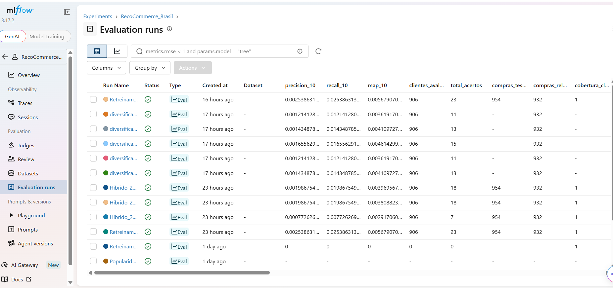

# RecoCommerce Brasil

Sistema de recomendação de produtos para uma operação de varejo digital brasileira, desenvolvido com foco em Ciência de Dados, Machine Learning, avaliação de modelos e práticas de MLOps.

< **[Acessar aplicação online](https://recocommercebrasil-7qqqmafvwqmua478v8pqsn.streamlit.app/)**

## Visão geral

O RecoCommerce Brasil implementa um pipeline de dados de e-commerce que contempla geração e preparação de dados, análise exploratória, construção de estratégias de recomendação, avaliação de modelos e disponibilização dos resultados em uma aplicação interativa desenvolvida com Streamlit.

O projeto também utiliza MLflow para rastreamento e comparação de experimentos, permitindo acompanhar métricas e parâmetros das diferentes execuções.

## Transparência dos dados

A primeira versão utiliza dados gerados programaticamente para simular uma operação de e-commerce. Eles permitem desenvolver e testar o pipeline, mas não representam transações observadas de uma empresa real.

Consequentemente, os resultados apresentados são métricas experimentais obtidas nessa base e não devem ser interpretados como impacto comercial comprovado.

## Estratégias de recomendação

Foram implementadas e comparadas três estratégias:

- **Popularidade Global:** recomenda produtos com maior pontuação ponderada de interações.
- **Similaridade Item-Item:** utiliza similaridade de cosseno entre produtos, considerando o histórico de interações dos clientes.
- **Híbrido com fallback:** utiliza similaridade Item-Item e recorre à popularidade quando não há histórico suficiente para gerar recomendações.

### Ponderação das interações

| Tipo de interação | Peso |
|---|---:|
| Visualização | 1 |
| Clique | 2 |
| Carrinho | 3 |
| Compra | 5 |

Essa ponderação atribui maior importância às interações que demonstram intenção de compra.

## Avaliação dos modelos

A avaliação utiliza divisão temporal dos dados, com treinamento em interações anteriores a julho de 2026 e teste em interações posteriores.

Foram avaliados 906 clientes com compras relevantes de produtos ainda não observados no treinamento.

### Métricas de avaliação

- **Precision@10:** proporção de recomendações relevantes entre os dez primeiros itens.
- **Recall@10:** proporção dos itens relevantes recuperados nas dez primeiras recomendações.
- **MAP@10:** média da precisão considerando a posição dos itens relevantes.
- **Cobertura de clientes:** percentual de clientes que receberam recomendações.
- **Cobertura do catálogo:** percentual de produtos contemplados pelas recomendações.

### Resultados comparativos

| Modelo | Precision@10 | Recall@10 | MAP@10 | Cobertura de clientes | Cobertura do catálogo |
|---|---:|---:|---:|---:|---:|
| Popularidade Global | 0,000221 | 0,002208 | 0,000552 | 100% | 0,60% |
| Similaridade Item-Item | 0,002539 | 0,025386 | 0,005679 | 99,89% | 94,75% |
| Híbrido com fallback | 0,002539 | 0,025386 | 0,005679 | 100% | 94,75% |

### Principais observações

- A Similaridade Item-Item apresentou métricas de relevância superiores às da Popularidade Global.
- A Similaridade Item-Item alcançou cobertura de 94,75% do catálogo, contra 0,60% da Popularidade Global.
- O modelo híbrido aumentou a cobertura de clientes para 100%, utilizando popularidade como alternativa para clientes sem histórico.
- O fallback resolveu a ausência de recomendações para o caso de cold start identificado, mas não gerou acertos para esse cliente no conjunto de teste.

Os resultados indicam oportunidades de melhoria na relevância das recomendações, especialmente para clientes novos.

## Análises e visualizações

O projeto contempla análises exploratórias para compreender o comportamento dos clientes, a distribuição das interações e o desempenho das estratégias de recomendação.

Entre os aspectos analisados estão:

- Distribuição dos tipos de interação.
- Comportamento de compras por categoria.
- Popularidade e desempenho dos produtos.
- Indicadores de rentabilidade.
- Comparação das estratégias de recomendação.

**Galeria de gráficos:** os gráficos gerados pelo projeto devem ser apresentados nesta seção, utilizando os arquivos de imagem versionados no repositório.

## Monitoramento de experimentos com MLflow

O MLflow é utilizado para registrar e comparar as execuções de avaliação dos modelos.

O monitoramento permite acompanhar indicadores como:

- Precision@10.
- Recall@10.
- MAP@10.
- Total de acertos.
- Clientes avaliados.
- Compras no conjunto de teste.
- Cobertura do catálogo.

A captura abaixo apresenta a interface de Evaluation Runs do experimento RecoCommerce_Brasil, com diferentes execuções registradas e suas métricas.



## Aplicação Streamlit

A aplicação disponibiliza uma interface interativa para explorar as recomendações geradas pelo sistema.

**Acesse:** [RecoCommerce Brasil — Aplicação online](https://recocommercebrasil-7qqqmafvwqmua478v8pqsn.streamlit.app/)

## Estrutura do projeto

- `data/raw`: dados de entrada.
- `data/processed`: dados tratados utilizados pelo pipeline e pela aplicação.
- `src/data`: geração e validação dos dados.
- `src/preprocessing`: limpeza e preparação.
- `src/visualization`: análises e geração de gráficos.
- `src/models`: modelos e avaliação.
- `app`: aplicação Streamlit.
- `docs`: documentação técnica e materiais do projeto.

## Início rápido (Windows)

```bat
py -3.11 -m venv .venv
.venv\Scripts\activate
python -m pip install --upgrade pip
pip install -r requirements.txt
python -m src.data.gerar_dados
```

Para executar a aplicação:

```bat
streamlit run app\app.py
```

## Documentação técnica

A documentação detalhada da metodologia, avaliação, métricas, resultados e limitações está disponível em:

[`docs/avaliacao_modelos.md`](docs/avaliacao_modelos.md)

## Próximas melhorias

1. Investigar estratégias para aumentar a relevância das recomendações.
2. Melhorar o tratamento de cold start para clientes e produtos novos.
3. Avaliar recomendações por região e categoria.
4. Explorar métricas de diversidade e novidade.
5. Ampliar o rastreamento de experimentos e modelos com MLflow.

## Tecnologias

Python, Pandas, NumPy, SciPy, scikit-learn, MLflow e Streamlit.

---

<<<<<<< HEAD
**RecoCommerce Brasil** — projeto de portfólio em Ciência de Dados e Sistemas de Recomendação.

=======
**RecoCommerce Brasil** — projeto de portfólio em Ciência de Dados, Machine Learning e Sistemas de Recomendação.
### Monitoramento do MLflow

A imagem abaixo apresenta o acompanhamento dos experimentos,
com comparação das métricas e dos resultados dos modelos.


>>>>>>> 92931a6 (Atualiza README com aplicativo e monitoramento MLflow)
